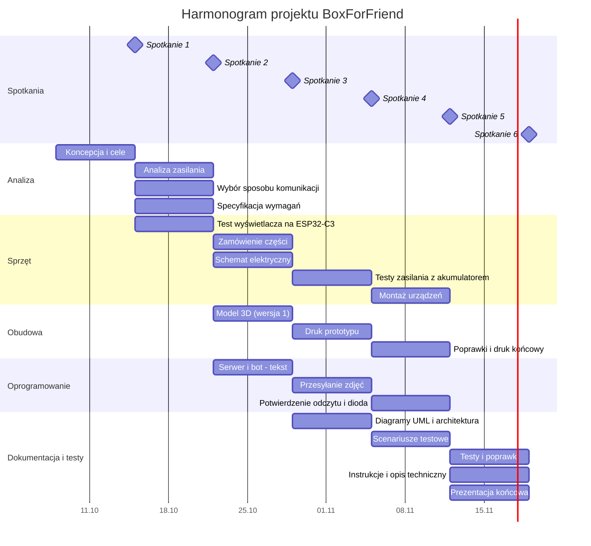

# Harmonogram i podział prac

Spotkania z prowadzącym odbywają się w czwartki. Jeden sprint = jeden tydzień między spotkaniami.

| Spotkanie | Data | Cel sprintu, który kończy się tym spotkaniem |
|---|---|---|
| 1 | 15.10.2026 | Koncepcja, cele, zespół, plan pracy |
| 2 | 22.10.2026 | Decyzje: zasilanie i sposób komunikacji; specyfikacja wymagań; pierwszy test wyświetlacza |
| 3 | 29.10.2026 | Model 3D obudowy; przesyłanie tekstu z telefonu na urządzenie; schemat elektryczny |
| 4 | 05.11.2026 | Prototyp obudowy; przesyłanie zdjęć; testy zasilania; diagramy UML |
| 5 | 12.11.2026 | Montaż w obudowie; potwierdzenie odczytu; scenariusze testowe |
| 6 | 19.11.2026 | Testy, instrukcje, dokumentacja końcowa, prezentacja |
| 7–8 | 26.11, 03.12.2026 | Rezerwa na opóźnienia i poprawki |

## Wykres Gantta

## Pakiety zadań (WBS)

| Pakiet | Zadanie | Odpowiedzialny | Termin | Osoby zaangażowane |
|---|---|---|---|---|
| 1. Analiza | 1.1 Koncepcja i cele projektu | Valentyn | 15.10 | Valentyn, Daria |
| | 1.2 Analiza wariantów zasilania | Valentyn | 22.10 | Valentyn |
| | 1.3 Wybór sposobu przesyłania wiadomości | Valentyn | 22.10 | Valentyn, Daria |
| | 1.4 Specyfikacja wymagań funkcjonalnych i niefunkcjonalnych | Daria | 22.10 | Daria, Valentyn |
| 2. Sprzęt | 2.1 Test wyświetlacza na ESP32-C3 | Valentyn | 22.10 | Valentyn, Claude |
| | 2.2 Zamówienie brakujących części | Valentyn | 29.10 | Valentyn |
| | 2.3 Schemat elektryczny | Daria | 29.10 | Daria, Valentyn |
| | 2.4 Testy zasilania z akumulatorem | Valentyn | 05.11 | Valentyn |
| | 2.5 Montaż urządzeń w obudowie | Valentyn | 12.11 | Valentyn |
| 3. Obudowa | 3.1 Model 3D obudowy (wersja 1) | Daria | 29.10 | Daria |
| | 3.2 Druk prototypu obudowy | Aleksander | 05.11 | Aleksander, Daria |
| | 3.3 Poprawki modelu i druk końcowy | Daria | 12.11 | Daria, Aleksander |
| 4. Oprogramowanie | 4.1 Serwer i bot: przesyłanie tekstu | Valentyn | 29.10 | Valentyn, Claude |
| | 4.2 Przesyłanie i wyświetlanie zdjęć | Valentyn | 05.11 | Valentyn, Claude |
| | 4.3 Potwierdzenie odczytu, dioda, przycisk | Valentyn | 12.11 | Valentyn, Claude |
| 5. Dokumentacja i testy | 5.1 Diagramy UML i architektura systemu | Daria | 05.11 | Daria |
| | 5.2 Scenariusze testowe | Daria | 12.11 | Daria |
| | 5.3 Przeprowadzenie testów i poprawki | Daria | 19.11 | Daria, Valentyn |
| | 5.4 Instrukcja użytkownika | Daria | 19.11 | Daria, Gemini |
| | 5.5 Instrukcja administratora i opis techniczny | Valentyn | 19.11 | Valentyn, Claude |
| | 5.6 Prezentacja końcowa | Valentyn | 19.11 | Valentyn, Daria |

## Macierz RAM

**R** – odpowiedzialny (wykonuje), **C** – konsultowany, **I** – informowany.

| Zadanie | Valentyn | Daria | Aleksander |
|---|---|---|---|
| 1.1 Koncepcja i cele | R | C | |
| 1.2 Analiza zasilania | R | I | I |
| 1.3 Sposób przesyłania wiadomości | R | C | |
| 1.4 Specyfikacja wymagań | C | R | |
| 2.1 Test wyświetlacza | R | I | |
| 2.2 Zamówienie części | R | I | |
| 2.3 Schemat elektryczny | C | R | |
| 2.4 Testy zasilania | R | I | |
| 2.5 Montaż urządzeń | R | C | |
| 3.1 Model 3D obudowy | C | R | C |
| 3.2 Druk prototypu | I | C | R |
| 3.3 Poprawki i druk końcowy | C | R | R |
| 4.1 Serwer i bot: tekst | R | I | |
| 4.2 Przesyłanie zdjęć | R | I | |
| 4.3 Potwierdzenie odczytu | R | C | |
| 5.1 Diagramy UML | C | R | |
| 5.2 Scenariusze testowe | C | R | |
| 5.3 Testy i poprawki | R | R | |
| 5.4 Instrukcja użytkownika | C | R | |
| 5.5 Instrukcja administratora, opis techniczny | R | C | |
| 5.6 Prezentacja końcowa | R | R | |

Narzędzia AI (Claude, Gemini) nie są ujęte w macierzy jako osoby odpowiedzialne: wspierają zadania, a za ich wynik odpowiada osoba oznaczona literą R.
