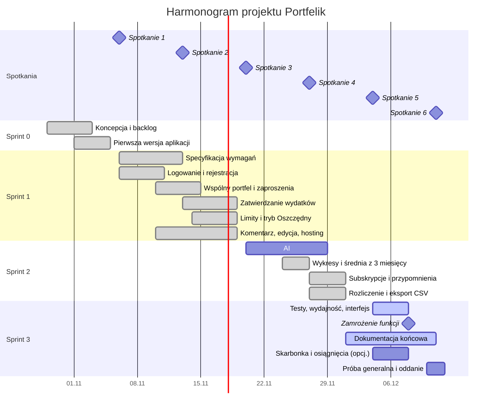

# Harmonogram i podział prac

Pracujemy w sprintach dwutygodniowych (zgodnie z modyfikacją metody Scrum przyjętą na zajęciach). Co tydzień, w piątek, odbywa się spotkanie z prowadzącym podsumowujące prace.

| Sprint | Termin | Cel |
|---|---|---|
| 0 | 29.10 – 05.11.2026 | Zmiana tematu, koncepcja, backlog, pierwsza działająca wersja |
| 1 | 06.11 – 19.11.2026 | Logowanie, wspólny portfel z zapraszaniem, zatwierdzanie wydatków, limity |
| 2 | 20.11 – 03.12.2026 | AI: paragony, wykresy, subskrypcje, rozliczenie, eksport CSV |
| 3 | 04.12 – 11.12.2026 | Jakość bez nowych funkcji: testy, wydajność, przegląd interfejsu, dokumentacja końcowa; skarbonka i osiągnięcia tylko przy wolnym czasie |

| Spotkanie | Data | Co pokazujemy |
|---|---|---|
| 1 | 06.11.2026 | Nowy temat, role, backlog, pierwsza wersja aplikacji |
| 2 | 13.11.2026 | Logowanie, specyfikacja wymagań |
| 3 | 20.11.2026 | Zatwierdzanie wydatków, limity; przegląd sprintu 1 |
| 4 | 27.11.2026 | Rozpoznawanie paragonów przez AI |
| 5 | 04.12.2026 | Wykresy, subskrypcje, rozliczenie, eksport; przegląd sprintu 2 |
| 6 | 11.12.2026 | Wersja końcowa, testy, dokumentacja, oddanie |

## Wykres Gantta

## Pakiety zadań (WBS)

| Pakiet | Zadanie | Odpowiedzialny | Czas | Osoby zaangażowane |
|---|---|---|---|---|
| 1. Analiza | 1.1 Koncepcja funkcji aplikacji | Daria | 2 dni | Daria, Valentyn |
| | 1.2 Backlog i priorytety | Daria | 1 dzień | Daria, Valentyn |
| | 1.3 Specyfikacja wymagań (F/NF) | Daria | 2 dni | Daria, Filip |
| | 1.4 Makiety nowych ekranów (zatwierdzanie, limity) | Daria | 1 dzień | Daria, Valentyn |
| 2. Organizacja | 2.1 Zmiana tematu, kontakt z prowadzącym | Valentyn | 1 dzień | Valentyn |
| | 2.2 Role, repozytorium, plan sprintów | Valentyn | 1 dzień | Valentyn, Daria, Filip |
| 3. Aplikacja | 3.1 Pierwsza wersja: portfele, wydatki, podsumowanie | Valentyn | 3 dni | Valentyn, Claude |
| | 3.2 Baza danych pod użytkowników i wspólne portfele | Valentyn | 1,5 dnia | Valentyn, Claude |
| | 3.3 Logowanie i wdrożenie aplikacji na serwer | Filip | 2,5 dnia | Filip, Valentyn, Claude |
| | 3.4 Zatwierdzanie wydatków i limity | Valentyn | 3,5 dnia | Valentyn, Daria, Claude |
| | 3.5 AI: rozpoznawanie paragonów | Valentyn | 3 dni | Valentyn, Claude |
| | 3.6 Wykres ze średnią z 3 miesięcy, subskrypcje | Filip | 2,5 dnia | Filip, Claude |
| | 3.7 Rozliczenie we wspólnym portfelu, eksport CSV | Valentyn | 1,5 dnia | Valentyn, Daria, Claude |
| | 3.8 Skarbonka, osiągnięcia (opcjonalnie, tylko przy wolnym czasie) | Valentyn | 2,5 dnia | Valentyn, Daria, Claude |
| 4. Jakość | 4.1 Przegląd interfejsu (ergonomia) | Filip | ciągle | Filip, Daria |
| | 4.2 Scenariusze testowe | Filip | 2 dni | Filip |
| | 4.3 Testy i zgłaszanie błędów | Filip | ciągle | Filip, Valentyn |
| | 4.4 Pomiar wydajności (NF7) i test użyteczności (NF5) | Filip | 1 dzień | Filip, Daria |
| 5. Dokumentacja | 5.1 Diagramy UML i architektura | Filip | 2 dni | Filip, Valentyn |
| | 5.2 Instrukcja użytkownika | Daria | 2 dni | Daria, Gemini |
| | 5.3 Instrukcja administratora, opis techniczny | Filip | 2 dni | Filip, Valentyn, Claude |
| | 5.4 Prezentacje na spotkania | Valentyn | co tydzień | wszyscy |

## Macierz RAM

R: odpowiedzialny, C: konsultowany, I: informowany.

| Zadanie | Valentyn | Daria | Filip |
|---|---|---|---|
| 1.1 Koncepcja funkcji | C | R | I |
| 1.2 Backlog i priorytety | C | R | I |
| 1.3 Specyfikacja wymagań | C | R | C |
| 1.4 Makiety nowych ekranów | C | R | I |
| 2.1 Zmiana tematu | R | I | I |
| 2.2 Role, repozytorium, plan | R | C | C |
| 3.1–3.2, 3.5, 3.7–3.8 Aplikacja | R | C | I |
| 3.3 Logowanie i wdrożenie na serwer | C | I | R |
| 3.4 Zatwierdzanie i limity (wykonał Filip, patrz odstępstwo) | C | C | R |
| 3.6 Wykres, subskrypcje | C | I | R |
| 4.1 Przegląd interfejsu | I | C | R |
| 4.2 Scenariusze testowe | C | C | R |
| 4.3 Testy | C | I | R |
| 4.4 Wydajność i test użyteczności | I | C | R |
| 5.1 Diagramy UML | C | I | R |
| 5.2 Instrukcja użytkownika | I | R | C |
| 5.3 Instrukcja administratora, opis techniczny | C | I | R |
| 5.4 Prezentacje | R | C | C |

## Zależności zadań

Zadania jednego pakietu nie ruszają równolegle, gdy jedno potrzebuje wyniku drugiego.

| Zadanie | Zależy od | Powód |
|---|---|---|
| Wspólny portfel i zaproszenia (F7) | Logowanie (F6), migracja `users` | Zaproszenie dopisuje zalogowanego użytkownika do portfela |
| Zatwierdzanie (F8) | F7 | Decyduje inny członek wspólnego portfela |
| Rozliczenie (F17) | F8 | Sumy liczą tylko zatwierdzone wydatki |
| Limity (F10) | F8 | Limity nie liczą wydatków oczekujących |
| Edycja (F19) | F6, F8 | Zmiana kwoty liczy status od nowa |
| Paragon (F11) | Hosting z dostępem do API modelu (NF11), próbka sprintu 1 | Bez dostępu do API funkcja nie działa na serwerze |
| Średnia z 3 miesięcy (F12) | F8 | Do średniej wchodzą tylko zatwierdzone wydatki |
| Testy akceptacyjne i dokumentacja końcowa | Zamrożenie funkcji 08.12 | Opisują stan końcowy |

**Odstępstwo od podziału w sprincie 1.** Zadania 3.4 (zatwierdzanie wydatków i limity) oraz tworzenie wspólnego portfela z zaproszeniami (F7), przypisane Valentynowi, wykonał Filip razem z zadaniem 3.3 (logowanie i wdrożenie). Filip wykonał też edycję wydatku (F19). Recenzję całości robi Valentyn przy scalaniu PR.

Narzędzia AI (Claude, Gemini) nie są osobami odpowiedzialnymi: wspierają zadania, a za wynik odpowiada osoba oznaczona literą R.
