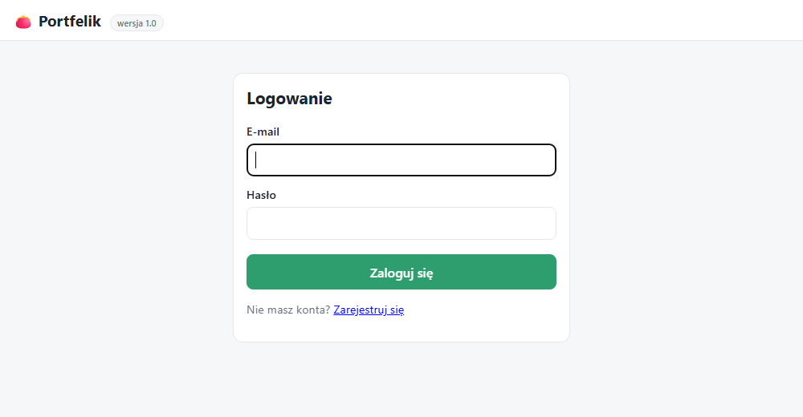
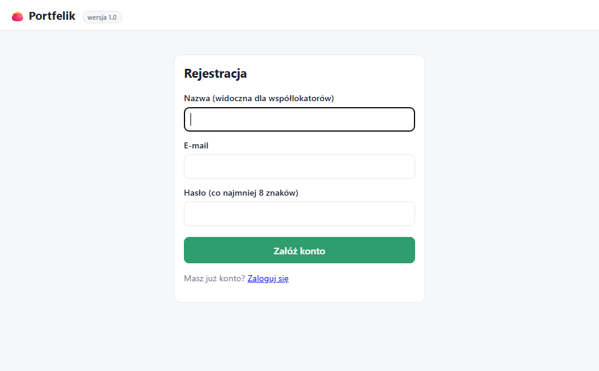
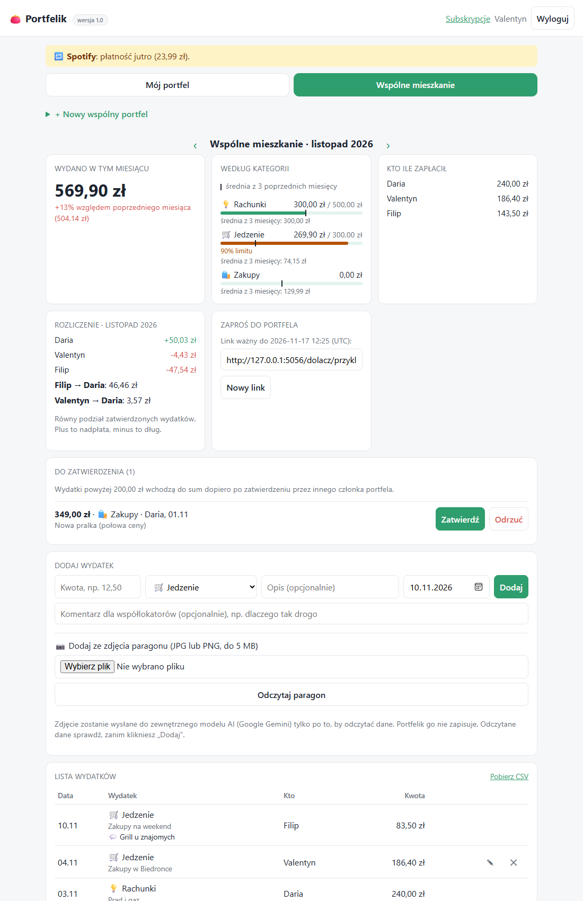
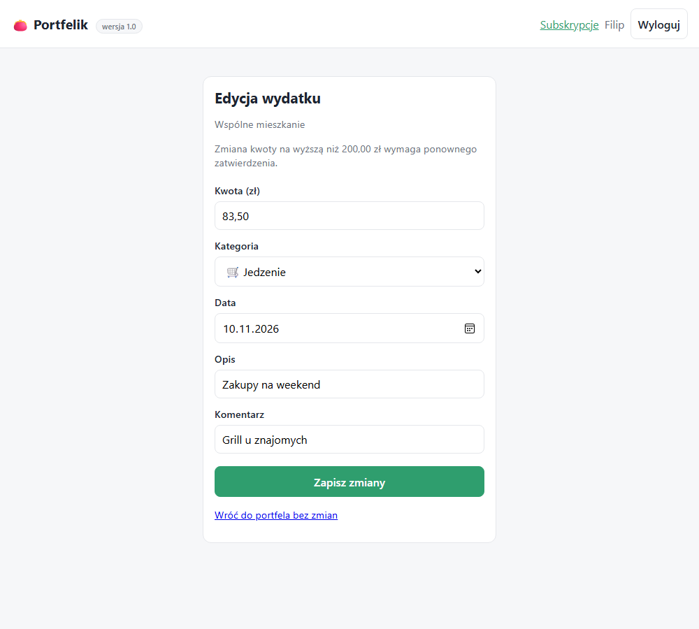
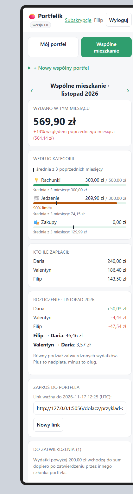
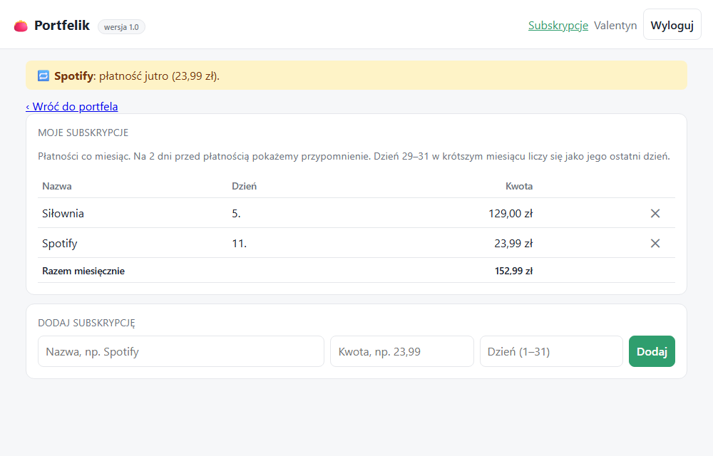

# Instrukcja użytkownika

Portfelik to aplikacja do prowadzenia budżetu osobistego i wspólnych wydatków. Działa w przeglądarce na telefonie i komputerze. Pod adresem aplikacji (na serwerze) albo http://127.0.0.1:5000 (uruchomienie lokalne) zobaczysz stronę logowania.

> Zrzuty ekranu pochodzą z bazy demonstracyjnej. Test użyteczności dodawania wydatku (3 kliknięcia) opisuje scenariusz TC-NF5-01 w [testy.md](testy.md).

## Konto

Na stronie `/rejestracja` podaj nazwę, e-mail i hasło (co najmniej 8 znaków). Po zalogowaniu widzisz swój portfel osobisty. Przycisk „Wyloguj” jest w prawym górnym rogu. 

Gdy podasz złe dane logowania, aplikacja pokaże ten sam komunikat niezależnie od tego, czy zły jest e-mail, czy hasło. Hasła nie da się odzyskać przez e-mail, więc zapamiętaj je albo zapisz w menedżerze haseł.

## Portfele

Zakładki nad podsumowaniem przełączają portfel osobisty i wspólne. 

 „+ Nowy wspólny portfel” tworzy portfel, a „Utwórz link zaproszenia” daje adres, który wysyłasz współlokatorom. Link działa 7 dni.

## Dodawanie wydatku

1. W karcie „Dodaj wydatek” wpisz kwotę (np. `12,50`), wybierz kategorię i datę. Opis i komentarz są opcjonalne.
2. Kliknij „Dodaj”.

Własny wydatek poprawisz przyciskiem ✎ (zmiana kwoty wspólnego wydatku powyżej progu wymaga ponownego zatwierdzenia), a usuniesz przyciskiem ✕. Cudzych wydatków nie da się edytować ani usuwać. 

### Ze zdjęcia paragonu

1. W karcie „Dodaj wydatek” wybierz plik JPG lub PNG do 5 MB i kliknij „Odczytaj paragon”.
2. Formularz wypełni się kwotą, datą, nazwą sklepu (w polu opisu) i kategorią. Sprawdź dane i popraw je, jeśli trzeba.
3. Kliknij „Dodaj”. Dopiero wtedy wydatek się zapisze.

Zdjęcie trafia do zewnętrznego modelu AI (Google Gemini) i nie jest zapisywane w Portfeliku. Gdy odczyt się nie uda, pojawi się komunikat i wydatek wpisujesz ręcznie.

## Wspólny portfel

- **Zatwierdzanie.** Wydatek powyżej progu (domyślnie 200 zł) czeka na decyzję innej osoby i nie wchodzi do sum. Karta „Do zatwierdzenia” ma przyciski „Zatwierdź” i „Odrzuć”. Własnego wydatku nie zatwierdzisz.
- **Rozliczenie.** Karta „Rozliczenie” dzieli zatwierdzone wydatki miesiąca po równo. Plus przy imieniu to nadpłata, minus to dług. Pod saldami widać, kto ma komu przelać ile.
- **Kto ile zapłacił** pokazuje sumy na osobę.

## Podsumowanie, limity i średnia

Karta „Według kategorii” pokazuje wydatki miesiąca. Pionowa kreska na pasku i napis „średnia z 3 miesięcy” to przeciętne wydatki kategorii z trzech poprzednich miesięcy. Właściciel portfela (osoba, która go utworzyła) ustawia limity i próg w „Ustawieniach portfela”. Puste pole limitu usuwa limit. Po wydaniu 80% limitu pasek robi się żółty, po przekroczeniu czerwony. 

**Tryb Oszczędny.** Gdy w bieżącym miesiącu wydasz ponad 80% sumy limitów, a miesiąc jeszcze trwa, nad podsumowaniem pojawia się baner „Tryb Oszczędny”. W poprzednich miesiącach i bez limitów baneru nie ma.

Strzałki „‹” i „›” przy nazwie miesiąca zmieniają miesiąc. Wydatki oczekujące i odrzucone nie liczą się do żadnych sum.

## Subskrypcje

Menu „Subskrypcje” (obok nazwy użytkownika) pokazuje listę z sumą miesięczną.  Dodaj nazwę, kwotę i dzień płatności. Na 2 dni przed płatnością, a także w dniu płatności, na górze strony pojawia się przypomnienie. Dzień 31 w miesiącu krótszym oznacza ostatni dzień tego miesiąca.

## Eksport do Excela

Odnośnik „Pobierz CSV” przy liście wydatków pobiera wydatki wybranego miesiąca. Plik otwiera się w Excelu z polskimi znakami, kolumny: data, kategoria, kwota, opis, osoba, status.

## Najczęstsze problemy

| Problem | Co zrobić |
|---|---|
| Link zaproszenia nie działa | Zaproszenie wygasa po 7 dniach. Poproś właściciela portfela o nowy link |
| „Nie udało się odczytać kwoty” przy paragonie | Wpisz kwotę ręcznie; pozostałe pola są już wypełnione. Pomaga ostre zdjęcie całego paragonu |
| „Plik jest za duży” | Zdjęcie paragonu może mieć najwyżej 5 MB. Zmniejsz je lub zrób nowe w niższej rozdzielczości |
| Wydatek nie wchodzi do sumy | Prawdopodobnie czeka na zatwierdzenie (status „oczekuje”) albo został odrzucony |
| Nie widzę przycisków „Zatwierdź” i „Odrzuć” | Własnych wydatków nie zatwierdzasz. Zrobi to inny członek portfela |
| Wylogowało mnie | Zaloguj się ponownie; po zalogowaniu wrócisz na stronę otwieraną wcześniej |
