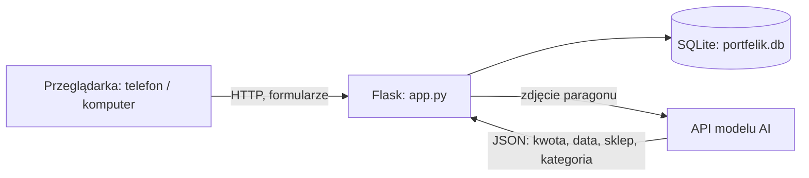
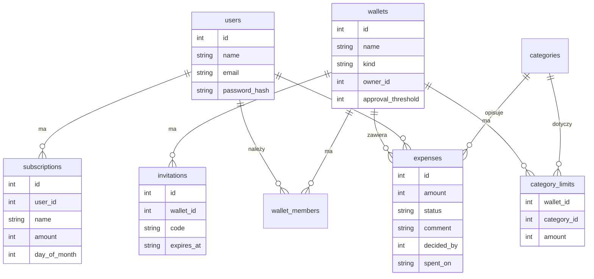

# Wymagania Portfelika

Stan z 10.11.2026. Źródła: repozytorium, wytyczne prowadzącego, `docs/backlog.md`. Pozycje oznaczone **(nowe)** lub **(zmiana)** wykraczają poza pierwotny backlog.

Priorytet: W (wysoki), Ś (średni), N (niski).

## 1. Cel i zakres

**Cel.** Aplikacja webowa do prowadzenia budżetu osobistego i wspólnych wydatków (para, współlokatorzy, rodzina). Użytkownik ma portfel osobisty, grupa ma portfel wspólny. System podsumowuje wydatki, pilnuje limitów, wymaga zatwierdzania większych wspólnych wydatków i dodaje wydatek na podstawie zdjęcia paragonu (AI).

**W zakresie.** Rejestracja i logowanie, portfele osobiste i wspólne, wydatki z kategoriami, zatwierdzanie i limity. Do tego rozpoznawanie paragonów, wykresy, subskrypcje, rozliczenia we wspólnym portfelu i eksport CSV. Aplikacja ma działać na serwerze dostępnym z telefonu.

**Poza zakresem.** Integracja z bankami (PSD2), prawdziwe przelewy, natywna aplikacja mobilna, powiadomienia Telegram (F16), wiele walut.

**Rodzaj projektu.** Wyłącznie oprogramowanie. Punkty 7 i 9 wytycznych o układach elektronicznych i mechanicznych nie dotyczą projektu.

## 2. Wymagania funkcjonalne

| ID | Wymaganie (user story) | Kryteria akceptacji | Pri. | Sprint | Wykonawca |
|---|---|---|---|---|---|
| F1 | Jako użytkownik dodaję wydatek (kwota, kategoria, data, opis) | Kwota > 0 i ≤ 1 000 000 zł, przyjmuje „,” i „.”; błędne dane dają komunikat i nie zapisują wydatku; opis do 200 znaków | W | 0 (zrobione) | Valentyn |
| F2 | Jako użytkownik przełączam portfel osobisty i wspólny | Przełączenie jednym kliknięciem; widzę tylko portfele, których jestem członkiem | W | 0 (zrobione) | Valentyn |
| F3 | Jako użytkownik widzę podsumowanie miesiąca według kategorii i porównanie z poprzednim miesiącem | Suma miesiąca, suma poprzedniego, różnica procentowa; nawigacja po miesiącach | W | 0 (zrobione) | Valentyn |
| F4 | Jako członek wspólnego portfela widzę, kto ile zapłacił w miesiącu | Lista członków z sumami, także dla osób z zerem | Ś | 0 (zrobione) | Valentyn |
| F5 | Jako autor usuwam własny wydatek | Przycisk tylko przy własnych wydatkach; próba usunięcia cudzego daje komunikat błędu | Ś | 0 (zrobione) | Valentyn |
| F6 | Jako użytkownik rejestruję się i loguję | Rejestracja: nazwa, e-mail, hasło min. 8 znaków; hasło zapisane jako skrót; błędne logowanie nie ujawnia, czy zły jest e-mail czy hasło; wylogowanie; bez logowania brak dostępu do portfeli; przełącznik `/user` usunięty | W | 1 | Filip |
| F7 | Jako użytkownik tworzę wspólny portfel i zapraszam osoby | Kreator portfela; zaproszenie linkiem lub kodem z terminem ważności; zaproszona osoba dołącza po zalogowaniu; użytkownik może należeć do wielu wspólnych portfeli; adres portfela zawiera jego identyfikator **(zmiana)** | W | 1 | Filip (planowo Valentyn) |
| F8 | Jako członek wspólnego portfela zatwierdzam większe wydatki | Domyślny próg 200 zł, zmienialny przez właściciela portfela; wydatek powyżej progu ma status „oczekuje”; zatwierdzić lub odrzucić może tylko inny członek niż autor; wydatek odrzucony zostaje w historii; oczekujące i odrzucone nie wchodzą do sum miesiąca ani do limitów; „powyżej progu” oznacza ostro więcej (200,00 zł przy progu 200 zł jest zatwierdzone od razu); próg zmienia tylko właściciel portfela; decyzja jest ostateczna (odrzuconego nie da się zatwierdzić); edycja kwoty liczy status od nowa, zmiana samego opisu lub komentarza go nie zmienia; autor może usunąć swój wydatek w każdym statusie (kryteria przyjęte w implementacji, czekają na potwierdzenie przez Właściciela produktu) | W | 1 | Filip (planowo Valentyn) |
| F9 | Jako użytkownik dodaję komentarz do wydatku | Komentarz do 200 znaków, widoczny na liście (także na telefonie) i przy zatwierdzaniu | Ś | 1 | Filip |
| F10 | Jako użytkownik ustawiam limity kategorii i dostaję ostrzeżenie | Limit miesięczny na kategorię w portfelu; ostrzeżenie przy 80% limitu; tryb „Oszczędny” włącza się, gdy wydano ponad 80% sumy limitów przed końcem miesiąca (wydano ponad 80% sumy limitów kategorii, które mają limit, a nie jest ostatni dzień miesiąca; baner tylko w bieżącym miesiącu); ostrzeżenie od 80% włącznie, dokładnie 100% limitu to jeszcze ostrzeżenie, a przekroczenie zaczyna się powyżej; limity zmienia tylko właściciel portfela (definicja przyjęta w implementacji, czeka na potwierdzenie przez Właściciela produktu) | W | 1 | Filip (planowo Valentyn) |
| F11 | **AI:** jako użytkownik dodaję wydatek ze zdjęcia paragonu | Wgranie JPG lub PNG do 5 MB; model zwraca kwotę, datę, sklep i kategorię; formularz jest wypełniony i edytowalny, wydatek zapisuje się dopiero po zatwierdzeniu; błąd odczytu daje komunikat i ręczne wprowadzanie; kwota odczytana poprawnie na co najmniej 8 z 10 paragonów testowych; zdjęcie nie jest zapisywane na dysku (NF6) | W | 2 | Valentyn |
| F12 | Jako użytkownik widzę wykres wydatków i porównanie ze średnią z 3 miesięcy | Wykres kategorii miesiąca ze znacznikiem średniej z 3 poprzednich miesięcy; czytelny na telefonie | Ś | 2 | Filip |
| F13 | Jako użytkownik prowadzę listę subskrypcji z przypomnieniem | Nazwa, kwota, dzień płatności, okres miesięczny; baner w aplikacji na 2 dni przed płatnością; dzień płatności 31 w krótszym miesiącu przypada na ostatni dzień miesiąca | Ś | 2 | Filip |
| F14 | Skarbonka z zaokrąglaniem i przeniesieniem niewydanych środków | Zaokrąglenie do pełnych złotych trafia do skarbonki; propozycja przeniesienia reszty na koniec miesiąca | N | 3, jeśli zostanie czas | Valentyn |
| F15 | Osiągnięcia i „kary” za przekroczenie limitów | Co najmniej 3 osiągnięcia, żadnych prawdziwych płatności | N | 3, jeśli zostanie czas | Daria |
| F16 | Powiadomienia przez Telegram | Poza zakresem | – | – | – |
| F17 **(nowe)** | Jako członek wspólnego portfela widzę rozliczenie „kto komu” | Równy podział wydatków zatwierdzonych; saldo każdej osoby; lista przelewów wyrównujących | Ś | 2 | Valentyn |
| F18 **(nowe)** | Jako użytkownik eksportuję wydatki miesiąca do CSV | Kolumny: data, kategoria, kwota, opis, osoba, status; UTF-8 z BOM, żeby Excel pokazał polskie znaki; komórki zaczynające się od `=`, `+`, `-`, `@` poprzedzone apostrofem | Ś | 2 | Daria z Valentynem |
| F19 **(nowe)** | Jako autor edytuję własny wydatek | Zmiana kwoty, kategorii, daty i opisu; edycja kwoty zatwierdzonego wydatku powyżej progu cofa status do „oczekuje” | Ś | 1 | Filip |

## 3. Wymagania pozafunkcjonalne

| ID | Wymaganie | Miara sprawdzenia | Pri. | Sprint |
|---|---|---|---|---|
| NF1 | Interfejs po polsku, czytelny na telefonie i komputerze | Przegląd na ekranie 360 px i 1366 px, brak poziomego przewijania; opis i komentarz wydatku są widoczne także na ekranie 360 px | W | 0 (do testów) |
| NF2 | Kwoty w groszach (bez błędów zaokrągleń) | Test jednostkowy `parse_amount` i formatowania | W | 0 (zrobione) |
| NF3 | Uruchomienie lokalne jednym plikiem | `start.bat` uruchamia aplikację na czystym Windows z Pythonem 3.10+ | Ś | 0 (zrobione) |
| NF4 | Hasła jako skrót; użytkownik widzi tylko swoje portfele | Test: użytkownik A dostaje 404 dla portfela użytkownika B | W | 1 |
| NF5 | Dodanie wydatku w maksymalnie 3 kliknięciach od strony głównej | Test użyteczności na dwóch osobach | Ś | 1 (do testów) |
| NF6 | Zdjęcie paragonu nie jest przechowywane po odczycie | Brak pliku na dysku po zakończeniu żądania | Ś | 2 |
| NF7 | Strona ładuje się poniżej 1 s przy 1000 wydatków w portfelu | Pomiar na bazie wygenerowanej skryptem | Ś | 3 |
| NF8 **(nowe)** | Bezpieczeństwo aplikacji | `secret_key` ze zmiennej środowiskowej (sesje przeżywają restart); ochrona CSRF na formularzach POST; ciasteczka sesji z `HttpOnly` i `SameSite`; nieznana kwota (np. `inf`) nie powoduje błędu 500; nagłówki bezpieczeństwa (CSP, `X-Frame-Options`); limit prób logowania i odczytów paragonu | W | 1 |
| NF9 **(nowe)** | Prywatność i tajne dane | Klucz API modelu AI tylko w zmiennej środowiskowej, nie w repozytorium; użytkownik widzi informację, że obraz paragonu trafia do zewnętrznego modelu | W | 2 |
| NF10 **(nowe)** | Testowalność | Testy automatyczne (pytest) dla logiki kwot, dat, zatwierdzania, limitów, rozliczeń i uprawnień; uruchamiane jednym poleceniem i w GitHub Actions | Ś | 1–3 |
| NF11 **(nowe)** | Trwałość danych na serwerze | Hosting z trwałym dyskiem; kopia pliku bazy przed każdym wdrożeniem; po restarcie aplikacji dane i sesje są zachowane | W | 1 |

## 4. Architektura

Komponenty: `app.py` (trasy), `db.py` (schemat, migracje, dane demonstracyjne), `templates/`, `static/`. Nowe moduły: `auth.py` (F6), `budget.py` (F10, F17), `receipts.py` (F11), `tests/`.

### Model danych (docelowy)

Pola dodane względem obecnego `db.py`: `users.email`, `users.password_hash`, `wallets.approval_threshold`, `expenses.status`, `expenses.comment`, `expenses.decided_by`, `expenses.decided_at`, tabele `category_limits`, `invitations`, `subscriptions`. Zmiany schematu idą jako kolejne migracje według `PRAGMA user_version`.

### Diagramy UML do wykonania (wytyczna 8)

Przypadki użycia, klas lub ER (powyżej), sekwencji „odczyt paragonu”, stanów wydatku (oczekuje → zatwierdzony / odrzucony), blokowy architektury (powyżej).

## 5. Proces pracy (Scrum)

| Element | Ustalenie |
|---|---|
| Role | Właściciel produktu: Daria; Scrum Master: Valentyn; Zespół: Valentyn, Filip, Daria (zadania małe) |
| Backlog | Pozycje F i NF jako Issues na tablicy GitHub Projects, z etykietą sprintu i osobą |
| Sprint | Dwa tygodnie (sprint 1 i 2), sprint 3 jednotygodniowy poświęcony jakości |
| Spotkanie tygodniowe (piątek) | Co zrobiono i plan na kolejny tydzień; na końcu sprintu dodatkowo retrospektywa |
| Definition of Done | Kod w Pull Requeście zrecenzowanym przez drugą osobę; kryteria akceptacji spełnione i potwierdzone przez Właściciela produktu; test automatyczny dla nowej logiki; scenariusz testowy dopisany; działa na telefonie; backlog i dokumentacja zaktualizowane |
| Kod z AI | Przeglądany w PR i testowany, zgodnie z README |
| Branche | `main` chroniony; praca na gałęziach `feature/<ID>` |

## 6. Dokumentacja wymagana przez prowadzącego

| Nr | Wymaganie | Gdzie |
|---|---|---|
| 1 | Koncepcja i cele | `docs/koncepcja.md` |
| 2 | Specyfikacja F i NF | `docs/specyfikacja.md` (ten dokument) |
| 3 | Harmonogram z wykresem Gantta | `docs/harmonogram.md` |
| 4 | Opis zadań i pakietów zadań | `docs/harmonogram.md` (WBS) |
| 5 | Struktura podziału prac (pakiet, zadanie, odpowiedzialność, czas, osoby) | `docs/harmonogram.md` |
| 6 | Macierz RAM | `docs/harmonogram.md` |
| 7 | Schematy układów elektronicznych i mechanicznych | Nie dotyczy: `docs/koncepcja.md`, sekcja 8 |
| 8 | Diagramy systemu i procesów (UML) | `docs/uml.md` |
| 9 | Działający system | Aplikacja na serwerze |
| 10 | Koncepcja tworzenia oprogramowania | `docs/koncepcja.md`, sekcja 7 |
| 11 | Napisane kody | Repozytorium |
| 12 | Scenariusze testowe (cel, opis, dane wejściowe, oczekiwany wynik) | `docs/testy.md` |
| 13 | Instrukcja użytkownika | `docs/instrukcja-uzytkownika.md` |
| 14 | Instrukcja administratora (instalacja, pielęgnacja) | `docs/instrukcja-administratora.md` |
| 15 | Opis powykonawczy (pliki, baza, konfiguracja) | `docs/opis-techniczny.md` |

Kryteria oceny z wytycznych: kompletność i jakość aplikacji, kompletność dokumentacji, jakość i ergonomia interfejsu, osiągnięcie wymagań F i NF.

## 7. Ryzyka

| Ryzyko | Skutek | Reakcja |
|---|---|---|
| Zmiana tematu: wytyczne wymagają zgłoszenia dwa miesiące przed terminem, a temat zmieniono w listopadzie | Prowadzący może nie uznać projektu | Pisemne potwierdzenie akceptacji nowego tematu, wpis w `postepy.md` |
| F11 (AI) nie działa lub jest za drogie | Zniknie główna wartość projektu | Próbka w sprincie 1, limit kosztów, ręczne wprowadzanie jako zapas |
| Zewnętrzne API zablokowane na darmowym hostingu | F11 nie działa na serwerze | Sprawdzenie w próbce sprintu 1, zapasowo inny hosting |
| Wąskie gardło w osobie Valentyna | Opóźnienia sprintów 1 i 2 | Rebalans zadań, PR-y zamiast pracy jednej osoby |
| Sprint 3 bez bufora | Dokumentacja i testy w pośpiechu | Pisać scenariusze i dokumentację w trakcie, F14 i F15 opcjonalne |
| Utrata bazy na hostingu | Utrata danych demo i testowych | NF11, kopia bazy |
| Wyciek klucza API | Koszty i utrata konta | NF9, plik z sekretami w `.gitignore` |

## 8. Pytania otwarte

1. Jak wygląda „zmodyfikowany Scrum”? Plik `scrum.pptx` ze zdjęcia nie jest w folderze `wykłady`, więc proces opiera się na standardowym Scrumie.
2. Czy 11.12.2026 jest ostatecznym terminem oddania?
3. Czy wydatki „oczekujące” wchodzą do sum miesiąca? Jak dokładnie liczymy tryb „Oszczędny”? Przyjęte w implementacji: oczekujące i odrzucone nie wchodzą do sum; tryb Oszczędny liczy tylko kategorie z limitem. Do potwierdzenia przez Właściciela produktu, makiety w [makiety.md](makiety.md).
4. Który model AI (Gemini czy Claude), kto zakłada klucz API i jaki jest limit kosztów? **Rozstrzygnięte (model):** Gemini. **Rozstrzygnięte (klucz i koszt):** darmowy plan Gemini, koszt 0, bez płatnych rozliczeń (decyzja z 10.11.2026, patrz `postepy.md`).
5. **Rozstrzygnięte:** hosting PythonAnywhere, baza SQLite (opis w `instrukcja-administratora.md`).
