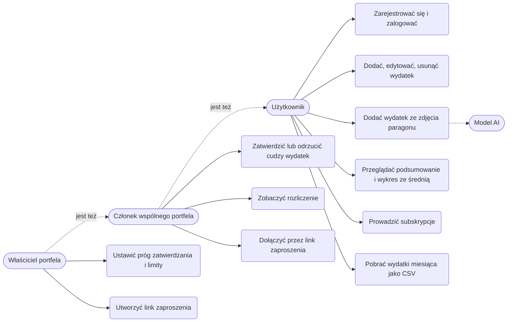
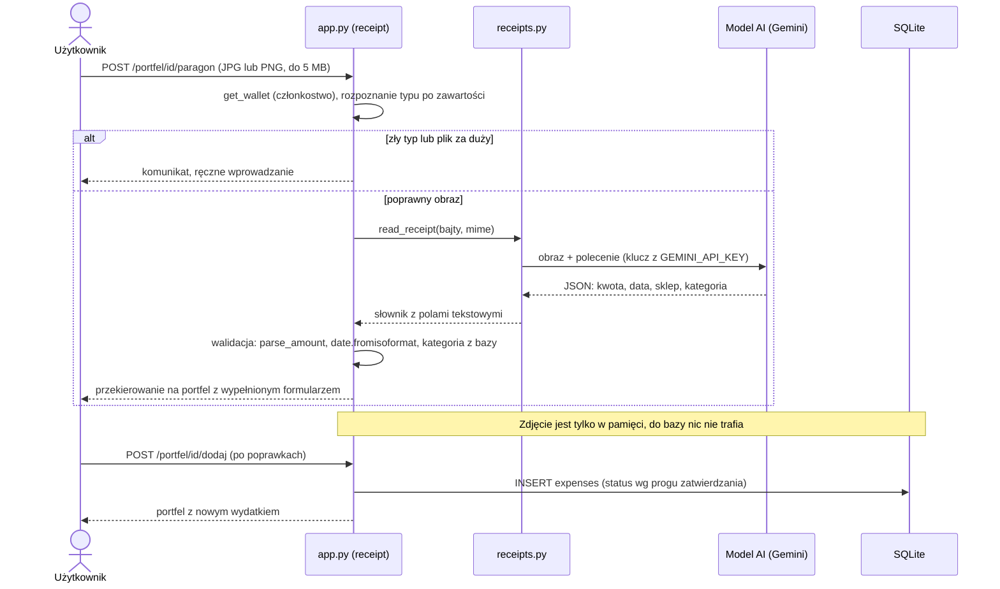
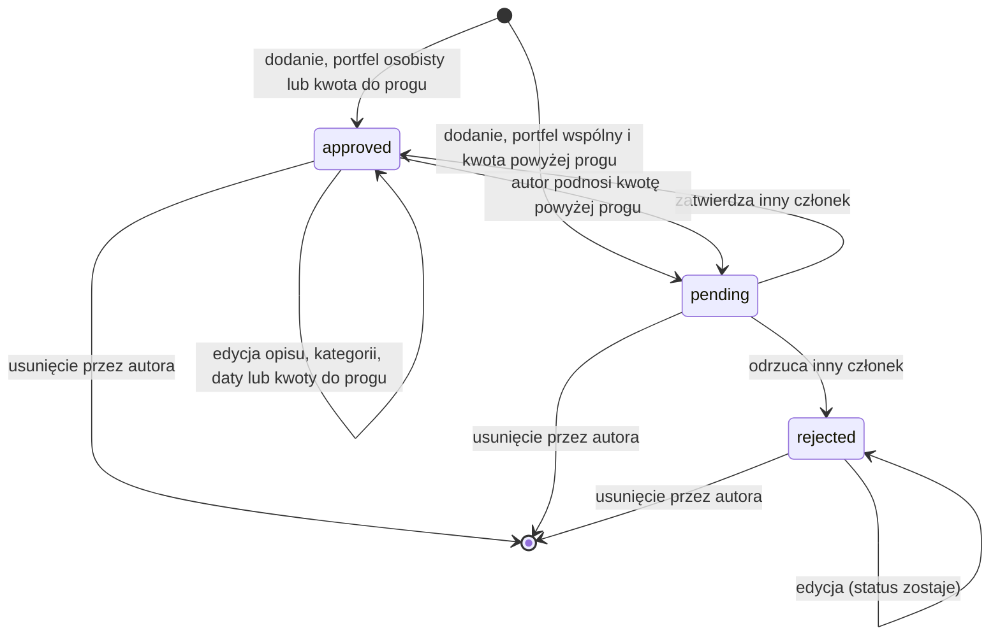

# Diagramy UML

Diagramy w składni Mermaid, GitHub rysuje je w podglądzie pliku. Architektura i model danych są w [specyfikacji](specyfikacja.md#4-architektura).

## Przypadki użycia

## Sekwencja: dodanie wydatku ze zdjęcia paragonu (F11)

## Stany wydatku

Do sum miesiąca, kategorii, osób, limitów i rozliczenia wchodzą tylko wydatki w stanie `approved`.
